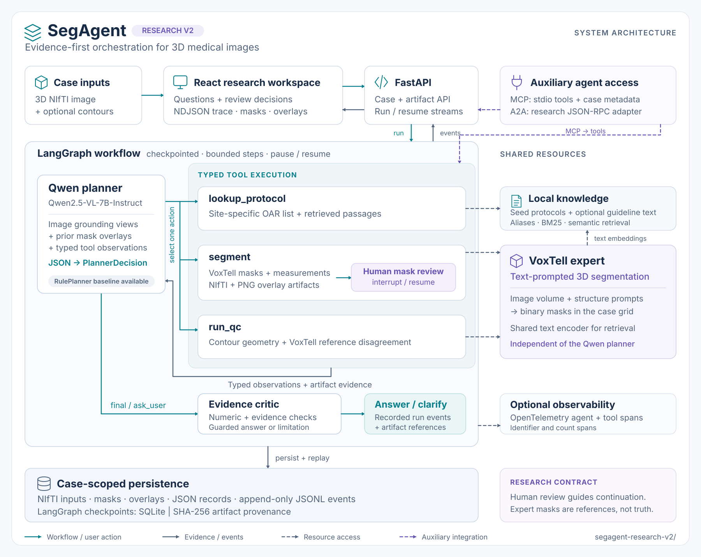

<div align="center">

# SegAgent

**语言引导的三维分割 · 类型化工具 · 可审查的证据**

将本地多模态规划器与 VoxTell 连接，用于医学影像分割和轮廓质量控制的研究框架。

[](LICENSE)
[](segagent-research-v2/pyproject.toml)
[](#研究边界)

[English](README.md) · [安装指南](docs/getting-started.md) · [架构说明](docs/architecture.md) · [配置参考](docs/configuration.md) · [贡献指南](CONTRIBUTING.md)

</div>



SegAgent 将规划与分割分开：**Qwen2.5-VL-7B-Instruct** 根据代表性二维切片和工具返回的观察选择结构化动作；**VoxTell** 对完整三维影像进行分割。系统记录测量值、叠加图、工具观察及审查决定，支持检查单次运行并从检查点恢复。

仓库保留两套实现。新使用者请从独立应用 **[`segagent-research-v2/`](segagent-research-v2/)** 开始；[`segagent/`](segagent/) 是需要集成到外部 VoxTell 网页插件的早期扩展。

> **研究软件。** 本项目未经临床验证，不是医疗器械。分割掩膜与 QC 结果需要专家解读；随附协议库为研究种子数据，不是获批临床指南。

## 主要能力

| 能力 | Research v2 的实际实现 |
| --- | --- |
| 类型化规划 | 通过 Pydantic 校验协议查询、分割、QC、澄清和最终回答五类动作。 |
| 三维分割 | 将文本提示传给 VoxTell，保存 NIfTI 掩膜、PNG 叠加图、体积、包围盒和质心等数据。 |
| 协议检索 | 查询本地 OAR 注册表，对用户补充的 Markdown / 文本文档进行词法与嵌入检索。 |
| 轮廓 QC | 检查几何一致性、空掩膜、拓扑、参考体积和左右侧，并与模型参考掩膜计算 Dice 一致性。 |
| 人工审查 | 图工作流产生分割后暂停，接收批准、拒绝或反馈，再从检查点继续。 |
| 可检查的运行记录 | React/NiiVue 查看器、NDJSON 工作流事件、文件形式的病例与运行记录、SQLite 检查点。 |
| 工具接入 | 三个 MCP 工具，以及实验性的 A2A JSON-RPC 适配器。 |

模型使用预训练权重，仓库没有训练或微调流程。网页传输的是工作流事件，不是逐 token 的模型推理流。

## 两套实现如何选择

| | Research v2 | 原始插件扩展 |
| --- | --- | --- |
| 目录 | `segagent-research-v2/` | `segagent/` |
| 形态 | 自带 FastAPI 后端与 React/NiiVue 前端 | 复制文件到外部 `voxtell-web-plugin` |
| 规划方式 | 类型化 JSON 动作 | 自由文本 ReAct 动作解析 |
| 状态管理 | 病例产物、运行记录、检查点恢复 | 原型实现自己的状态 |
| 文档 | [安装指南](docs/getting-started.md) | [旧版集成说明](docs/legacy.md) |

两者均需另行安装 VoxTell 并下载权重，配置变量和接口不能混用。本文描述的是当前 GitHub 仓库中的 Qwen2.5-VL 版本。

## 快速开始

需要 Python 3.11+、兼容的 PyTorch 环境、Node.js 22.12+ 和 VoxTell 模型。先按 [完整安装指南](docs/getting-started.md) 准备依赖与权重；本仓库尚无经实测验证的最低显存要求。

```bash
git clone https://github.com/Syndr0/SegAgent.git
cd SegAgent/segagent-research-v2
cp .env.example .env
```

编辑 `.env`：

```dotenv
SEGAGENT_PLANNER=qwen
SEGAGENT_LLM_MODEL=Qwen/Qwen2.5-VL-7B-Instruct
SEGAGENT_VOXTELL_MODEL=/absolute/path/to/voxtell_v1.1
SEGAGENT_REQUIRE_MASK_APPROVAL=true
```

在 `segagent-research-v2/` 启动后端：

```bash
uvicorn backend.api:app --host 127.0.0.1 --port 8000 --workers 1
```

另一个终端从仓库根目录启动前端：

```bash
cd segagent-research-v2/frontend
npm install
npm run dev -- --host 127.0.0.1 --strictPort
```

打开 [http://127.0.0.1:5173](http://127.0.0.1:5173)，上传 `.nii` / `.nii.gz` 扫描并提交请求。模型在首次使用时加载。示例 `.env` 原本选择 `rule` 基线；改成 `qwen` 才启用多模态规划器。`rule` 模式的分割和专家 QC 仍需要真实 VoxTell。

浏览器访问的后端地址由 `VITE_API_BASE_URL` 决定，与后端的 `SEGAGENT_API_BASE_URL` 不同。完整配置见 [环境变量参考](docs/configuration.md)。

## 一次运行的流程

1. 上传 NIfTI 扫描，可附加处于同一网格的轮廓掩膜。
2. 规划器根据图像切片、工具观察和 JSON schema 选择动作。
3. 工具检索协议、执行完整三维分割，或检查已上传轮廓。
4. 图工作流中的分割结果进入人工审查，接收批准、拒绝或反馈。
5. 将最终回答与测量值、产物、观察和事件轨迹一起检查。

该审查中断只覆盖图工作流里的分割，QC 参考掩膜和 MCP 直接调用不使用同一个审批门，下载接口也没有审批限制。病例产物可以跨运行保留，但新问题会开启新运行，当前实现没有跨问题的持久化聊天记忆。

## 文档导航

| 文档 | 内容 |
| --- | --- |
| [Getting started](docs/getting-started.md) | 依赖、权重、前后端与首次工作流 |
| [Architecture](docs/architecture.md) | 模块、工具、HTTP / MCP / A2A 接口与实现边界 |
| [Configuration](docs/configuration.md) | 后端与前端环境变量、路径与默认值 |
| [Legacy integration](docs/legacy.md) | 原始网页插件扩展的集成方法 |
| [Experiments](segagent-research-v2/EXPERIMENTS.md) | 研究比较、消融与结果报告方法 |
| [Contributing](CONTRIBUTING.md) | 缺陷报告、开发检查与提交约定 |
| [Security](SECURITY.md) | 研究环境的数据处理与漏洞报告 |

## 测试与研究边界

```bash
cd segagent-research-v2
pytest -q
python evals/run_evals.py --dataset evals/golden_cases.jsonl
```

已有单元测试针对 schema、规则规划、检索和存储；评估脚本使用文本规则规划样例。它们不能证明真实模型分割准确率、Qwen 表现或临床效果，仓库尚未发布实测基准结果。默认 QC 服务也没有启用表面距离指标。

## 研究边界

当前应用面向本地、去标识 NIfTI 数据研究，没有身份验证、自动去标识或生产部署栈。启发式证据检查和专家模型一致性不保证结果正确。DICOM 转换与 RTSTRUCT 相关代码属于旧版插件集成，不属于 v2 的上传接口。

## 贡献、引用与许可

欢迎提交可复现的问题、文档改进和研究贡献。请先阅读 [贡献指南](CONTRIBUTING.md)，不要在 issue 或 PR 中上传医疗影像、身份信息、凭据或模型权重。

使用本项目发表结果时，请记录仓库 commit、模型检查点、配置和数据划分，并按上游指引引用 [VoxTell](https://github.com/MIC-DKFZ/VoxTell)、[Qwen2.5-VL](https://huggingface.co/Qwen/Qwen2.5-VL-7B-Instruct) 等依赖。本仓库没有声明 SegAgent 论文或 DOI。

仓库贡献采用 [MIT 许可证](LICENSE)。外部依赖、预训练权重及上游派生组件仍受各自许可证约束。
